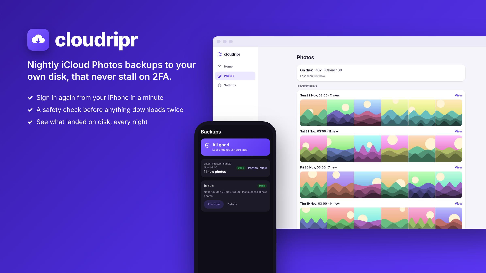
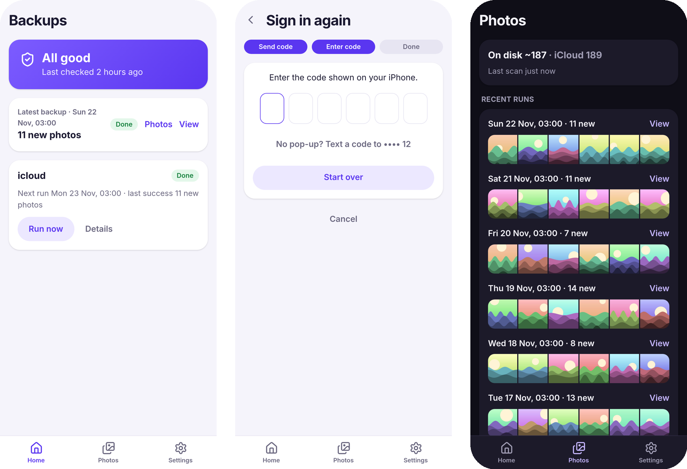
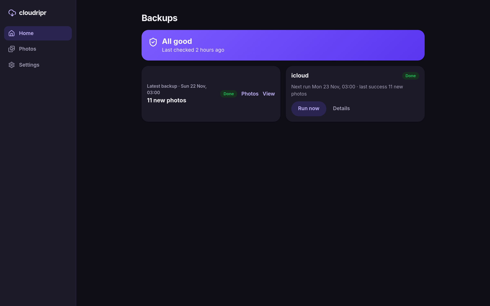
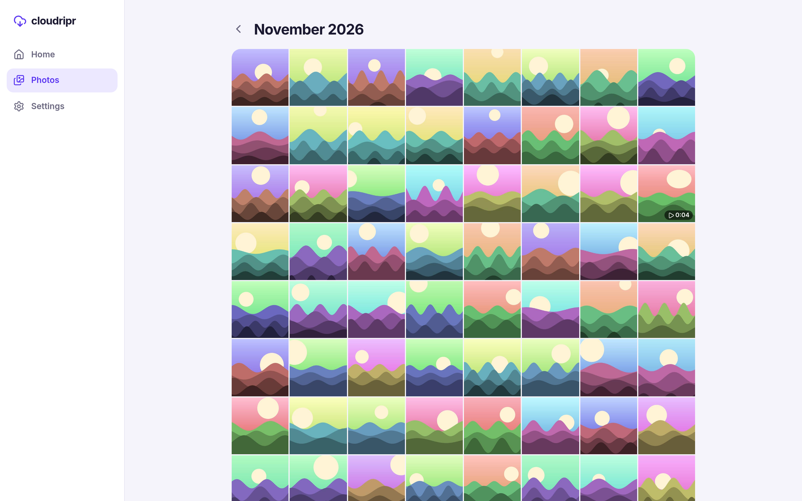

<p align="center">
  
</p>

# cloudripr

**Self-hosted, nightly iCloud Photos backups to your own disk, with an app that makes Apple's
two-factor sign-in painless.**

cloudripr runs the proven [icloudpd](https://github.com/icloud-photos-downloader/icloud_photos_downloader)
engine on a schedule and wraps it in a mobile-first web app. Every night it pulls the new photos
and videos from your iCloud library onto your server or NAS, and it makes sure the backup never
silently stops.

## Why

If you've run icloudpd unattended, you know how it goes: every few weeks Apple wants a fresh
two-factor sign-in, the nightly job sits waiting for a code nobody types, and you find out a
month later that nothing has been backed up. cloudripr is built around that problem:

- **Signing in again takes a minute, from your phone.** Tap the link in the alert email, the
  code pops up on your iPhone (or arrives by SMS), and you type it into six boxes that accept
  iOS code autofill. That's it.
- **Nightly runs never get stuck on 2FA.** Unattended runs stop cleanly before Apple would push a
  code, so you don't get a 2FA prompt at 3 a.m. and the job doesn't hang. You get an email instead.
- **A daily sign-in check** tells you in the evening, not after a failed night, when Apple wants
  you to sign in again.
- **Nothing downloads twice.** Before the first run, after you change how files are named, or
  after an engine update, cloudripr does a dry run first. If it would download suspiciously many
  files, it stops and shows you how many and where, and waits for your OK.
- **You can see that it worked.** The Photos tab shows each night's new files as thumbnails, the
  totals on disk vs. in iCloud, and flags any file that can't be read (an interrupted download).

## Screenshots

<p align="center">
  
</p>

<p align="center">
  
  
</p>

## Features

- Nightly (or any cron) backups of your **personal or shared** iCloud Photos library
- **Re-authentication from your phone**: push code or SMS, iOS code autofill
- **Email alerts** (Gmail preset, or any [Apprise](https://github.com/caronc/apprise) URL) when
  you need to sign in or a backup fails; optional "all good" emails
- **Safety dry run** before anything could download twice, with a review screen
- **Photos tab**: each run's new files, months with counts, totals vs. iCloud, unreadable files
  flagged, a simple viewer for photos and videos
- **File naming locked** after the first backup, so a stray setting can't reshuffle your library
- Live Photos, RAW, original or resized versions, Live Photo video naming, folder layout: the
  icloudpd download options you'd expect, in a form instead of a command line
- Optional iCloud clean-up (delete after download, keep recent days); off by default
- Filters to delete unwanted files after a run (screenshots, file types, camera models)
- Policy import/export as TOML
- Light and dark mode, phone and laptop layouts, *Add to Home Screen* for a full-screen app
- No telemetry and no external requests from the app; the font is bundled

## Quick start

You need Docker with Compose, on amd64 or arm64 (Raspberry Pi, Apple Silicon, most NASes).

1. Create a folder and a `docker-compose.yml`:

   ```yaml
   services:
     cloudripr:
       image: ghcr.io/jvspier/cloudripr:1
       container_name: cloudripr
       restart: unless-stopped
       init: true
       ports:
         - "8080:5000"
       environment:
         TZ: Europe/Amsterdam # your time zone: the schedule runs on it
       volumes:
         - ./data:/data # settings, Apple session, history: back this up
         - /path/to/your/photos:/downloads # where the library goes
         - ./cache:/cache # thumbnails and index: disposable
   ```

2. The container runs as user `1000`. Give it the folders:

   ```bash
   mkdir -p data cache
   sudo chown -R 1000:1000 data cache /path/to/your/photos
   docker compose up -d
   ```

3. Open `http://your-server:8080`:
   1. **Choose a login password** for the app.
   2. **Settings → Account:** enter your Apple ID and password.
   3. **Settings → Policies → New:** set the folder to `/downloads` and pick when it runs
      (default every night at 03:00). The folder layout and naming options are explained in the form.
   4. **Home → Sign in:** enter the code from your iPhone.
   5. **Run now**, or wait for the night. Into an empty folder it simply starts downloading; if
      the folder already holds photos, the first run is a dry run that checks nothing would be
      downloaded twice, and continues by itself when that's fine.
4. **Settings → Email alerts:** set them up so you hear when Apple wants you back.

On your iPhone, open the app in Safari and choose *Share → Add to Home Screen*.

### Already have a library from icloudpd?

Point the policy at the same folder and use the same naming settings as before (folder structure,
sizes, Live Photo naming, file match policy). The first run is a dry run: if your settings
don't match the files on disk, cloudripr shows you before anything is downloaded.

## Updating

```bash
docker compose pull && docker compose up -d
```

Your data in `/data` carries over. The `:1` tag follows all 1.x releases; pin an exact version
(`:1.0.0`) if you'd rather update by hand. After an update of the bundled icloudpd, the next run
quickly re-checks the newest photos (a short dry run) before downloading.

## Configuration

| Volume | What lives there |
|---|---|
| `/data` | Policies, Apple session, passwords, run history, settings. Small; **back it up.** |
| `/downloads` | Your photo library. Keep the host path stable. |
| `/cache` | Library index, thumbnails and previews (a few GB once every month has been opened). Safe to delete. Never put it inside the library. |

| Environment variable | Default | |
|---|---|---|
| `TZ` | UTC | Time zone for the schedule and the dates you see |
| `PORT` | `5000` | Port inside the container |
| `PASSWORD_HASH` | | Fix the login password instead of choosing it on first visit: `docker compose run --rm cloudripr init-password 'your password'`. In a `.env` file, wrap it in single quotes (it contains `$`). |
| `SESSION_SECRET` | generated | Cookie signing key; otherwise created once in `/data/app/session.key` |
| `HTTPS_ONLY` | | Set to `1` when cloudripr sits behind an HTTPS reverse proxy (secure cookies) |

## Security and privacy

- cloudripr is meant for your home network or a VPN such as Tailscale or WireGuard. To reach it
  from the internet, put it behind a reverse proxy with HTTPS and set `HTTPS_ONLY=1`.
- Your Apple ID password and the Apple session are stored in `/data`, readable only by the
  container's user. They're needed so nightly runs can sign in without you.
- The app login is rate-limited, and the API is only reachable after logging in.
- The app makes no requests to anything but Apple (through icloudpd) and your email provider.

## FAQ

**Does it work with the Shared Library?** Yes; pick *Shared* in the policy.

**More than one Apple ID?** One Apple ID per cloudripr install. Run a second container for a
second account.

**Will it delete anything from iCloud?** Only if you switch on the iCloud clean-up options in a
policy. They're off by default.

**Does it need Advanced Data Protection turned off?** icloudpd needs web access to iCloud
(*Settings → Apple ID → iCloud → Access iCloud Data on the Web*). With Advanced Data
Protection on, that has to be allowed.

**Can I see my photos in it?** Yes, as a check that the backup landed: thumbnails per night and
per month, and a simple viewer. For browsing and editing, use Apple Photos or a gallery app
(Immich, PhotoPrism) pointed at the same folder, read-only.

## Development

```bash
make build-web            # the Python package ships the built web app
uv sync --all-extras --dev
make dev-backend-sim      # backend with a simulated icloudpd, no Apple ID needed
make dev-web              # Vite dev server on :5173
make test                 # backend + frontend tests, lint, types
make screenshots          # regenerate the README images from demo data
```

Releases: see [RELEASING.md](RELEASING.md).

## Credits and license

cloudripr started as a fork of [icloudpd-web](https://github.com/AirswitchAsa/icloudpd-web) by
[AirswitchAsa](https://github.com/AirswitchAsa), and has since been rebuilt. The downloading is
done by [icloudpd](https://github.com/icloud-photos-downloader/icloud_photos_downloader).

Licensed under [CC BY-NC 4.0](LICENSE): free for personal, non-commercial use, with attribution.
cloudripr is not affiliated with Apple. Use it at your own risk and keep more than one backup
of what matters to you.
